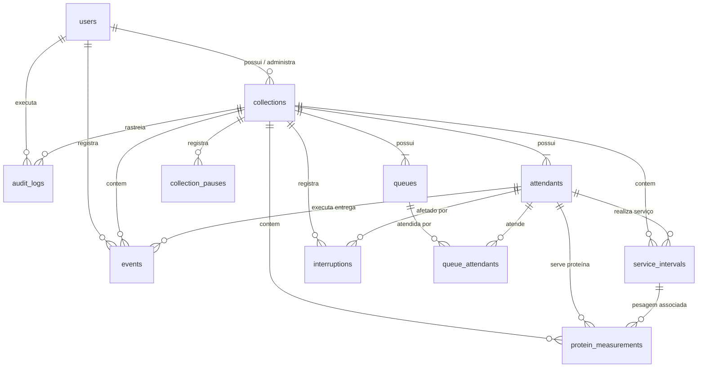

# Modelo Relacional e Esquema do Banco de Dados — RU Metrics

O banco de dados relacional foi modelado em PostgreSQL 16 e gerenciado através do Prisma ORM.

---

## 1. Diagrama Entidade-Relacionamento (ERD)

---

## 2. Dicionário de Dados das Tabelas Principais

### `users`
Armazena credenciais e identificação dos pesquisadores.
- `id` (UUID, PK)
- `name` (TEXT)
- `email` (TEXT, UNIQUE)
- `password_hash` (TEXT, bcrypt cost 10)
- `created_at`, `updated_at` (TIMESTAMP)

### `collections`
Representa uma sessão delimitada de observação no RU.
- `id` (UUID, PK)
- `owner_id` (UUID, FK -> `users.id`, CASCADE)
- `title` (TEXT)
- `description` (TEXT, opcional)
- `location` (TEXT, opcional)
- `timezone` (TEXT, padrão `'America/Sao_Paulo'`)
- `queue_mode` (ENUM: `SEPARATE_QUEUES`, `SINGLE_QUEUE`, `CUSTOM`)
- `status` (ENUM: `DRAFT`, `IN_PROGRESS`, `PAUSED`, `FINISHED`)
- `started_at`, `ended_at` (TIMESTAMP, UTC)
- `notes` (TEXT, opcional)
- **Índices:** `owner_id`, `status`.

### `attendants`
Canais de atendimento (ex.: Atendente A, Atendente B).
- `id` (UUID, PK)
- `collection_id` (UUID, FK -> `collections.id`, CASCADE)
- `code` (TEXT, ex.: `'A'`, `'B'`)
- `display_name` (TEXT, ex.: `'Atendente A'`)
- **Restrição:** UNIQUE (`collection_id`, `code`).

### `queues` e `queue_attendants`
Filas físicas ou lógicas e o mapeamento N:N com os atendentes.
- Permite modelar fila única (onde ambos atendentes atendem à mesma fila) ou filas separadas.

### `events`
Eventos atômicos primários observados no tempo.
- `id` (UUID, PK)
- `collection_id` (UUID, FK -> `collections.id`)
- `attendant_id` (UUID, FK -> `attendants.id`, NULL para chegadas gerais)
- `queue_id` (UUID, FK -> `queues.id`, opcional)
- `event_type` (ENUM: `ARRIVAL`, `DELIVERY`, `OBSERVATION`)
- `occurred_at` (TIMESTAMP, UTC, instante de ocorrência no RU)
- `recorded_at` (TIMESTAMP, UTC, instante de recebimento pelo servidor)
- `recorded_by` (UUID, FK -> `users.id`)
- `idempotency_key` (TEXT, UNIQUE, proteção contra duplicações)
- `metadata` (JSONB)
- `is_voided` (BOOLEAN, padrão `false`)
- `voided_at` (TIMESTAMP)
- `void_reason` (TEXT)
- **Índices:** `(collection_id, occurred_at)`, `(collection_id, attendant_id)`, `(collection_id, event_type)`, `(collection_id, is_voided)`.

### `service_intervals`
Intervalos cronometrados no modo individual (início e término).
- `id` (UUID, PK)
- `collection_id` (UUID, FK -> `collections.id`)
- `attendant_id` (UUID, FK -> `attendants.id`)
- `started_at`, `ended_at` (TIMESTAMP, UTC)
- `duration_ms` (INTEGER, milissegundos calculados)
- `status` (ENUM: `IN_PROGRESS`, `COMPLETED`, `CANCELLED`)
- **Índice:** `(collection_id, attendant_id, status)`.

### `collection_pauses`
Pausas na sessão geral (ex.: troca de cubas ou indisponibilidade coletiva).
- `id` (UUID, PK)
- `collection_id` (UUID, FK -> `collections.id`)
- `started_at`, `ended_at` (TIMESTAMP, UTC)
- `reason` (TEXT)

### `protein_measurements`
Módulo opcional de pesagem física das porções de proteína servidas.
- `id` (UUID, PK)
- `collection_id` (UUID, FK -> `collections.id`)
- `attendant_id` (UUID, FK -> `attendants.id`)
- `service_interval_id` (UUID, FK -> `service_intervals.id`, opcional)
- `amount` (FLOAT, em gramas)
- `unit` (TEXT, `'g'`)
- `measurement_method` (ENUM: `MEASURED`, `ESTIMATED`)
- `notes` (TEXT)

### `audit_logs`
Trilha imutável de alterações críticas (anulação de eventos, reabertura de coletas, etc.).
- `id` (UUID, PK)
- `user_id` (UUID, FK -> `users.id`)
- `collection_id` (UUID, FK -> `collections.id`)
- `action` (TEXT, ex.: `'EVENT_VOIDED'`, `'COLLECTION_REOPENED'`)
- `entity_type` (TEXT)
- `entity_id` (TEXT)
- `previous_values`, `new_values` (JSONB)
- `created_at` (TIMESTAMP)
